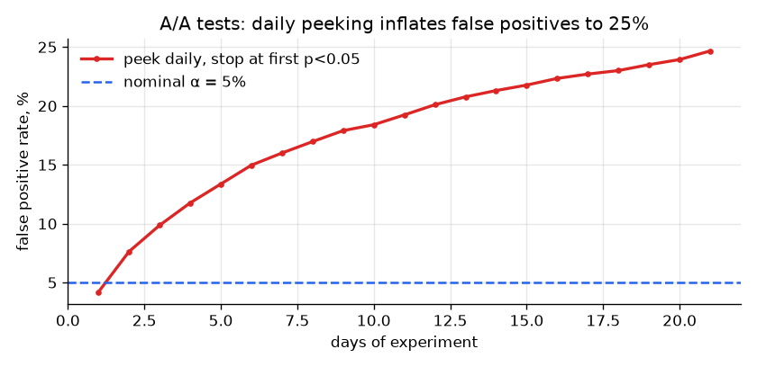
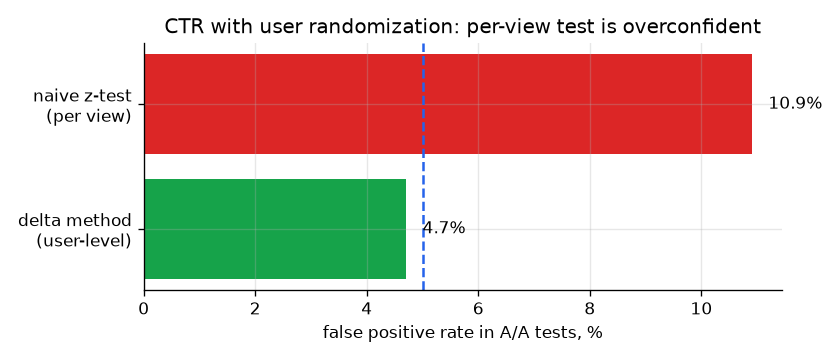
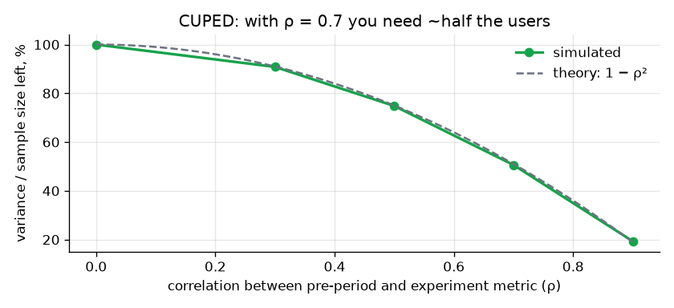

# abtk: A/B testing toolkit + simulations of common mistakes

[](https://github.com/kkchillbro/ab-testing-toolkit/actions/workflows/ci.yml)   

A small A/B testing library (NumPy + SciPy only), plus Monte-Carlo simulations showing **why** the usual rules exist. Every method is checked against SciPy or a closed-form result in [`tests/`](tests/).

| | what | why it matters |
|---|---|---|
| 📐 | sample size, MDE, test duration | decide *before* launch, not after |
| 🚦 | SRM check | a broken split invalidates every metric |
| 📊 | z-test, Welch t-test, bootstrap, **delta method** | correct variance for conversion, means, medians and ratio metrics |
| ✂️ | **CUPED** | fewer users needed for the same power |
| 🔁 | Holm, Benjamini–Hochberg | many metrics produce false winners |

## Key results from the simulations

[`simulations/run_simulations.py`](simulations/run_simulations.py) → [`reports/simulations.md`](reports/simulations.md)

### 1. Peeking turns a 5% error rate into 25%
3,000 A/A tests (no real difference), checked every day for 21 days, stopped at the first p < 0.05:



**Fixed horizon: 5.1% false positives. Daily peeking: 24.7%.** If the business needs to look early, use sequential tests (e.g., group sequential with O'Brien–Fleming bounds) or mSPRT. Don't just glance at a dashboard.

### 2. Wrong unit of analysis doubles false positives
Users are randomized, but CTR is often tested per view. Views from the same user are correlated, so the naive test underestimates variance:



**Naive per-view z-test: 10.9% FPR. Delta method at user level: 4.7%.**

### 3. CUPED: variance shrinks by 1 − ρ²



With ρ = 0.7 between pre-period and experiment metric, half the users give the same power. The [checkout example](reports/checkout_experiment.md) shows the other side: for sparse revenue (89% zeros) ρ ≈ 0.23 and CUPED saves only ~6%. Measure ρ on historical data first.

## End-to-end example: checkout redesign

[`examples/checkout_experiment.py`](examples/checkout_experiment.py) → [`reports/checkout_experiment.md`](reports/checkout_experiment.md)

Design → SRM → primary metric → secondary metrics (CUPED, delta method) → guardrail → Holm correction → decision.

| metric | control | treatment | lift | p-value |
|---|---|---|---|---|
| conversion (primary) | 10.46% | 11.45% | +9.4% | <0.0001 |
| revenue / user (CUPED) | 4.83 | 5.29 | +9.5% | 0.0011 |
| AOV (delta method) | 43.82 | 43.59 | −0.5% | 0.75 |
| refund rate (guardrail) | 3.56% | 4.32% | +21% | 0.09 |

**Decision: ship**, and keep the refund rate on the post-launch dashboard: it is not significantly worse, but the CI reaches +1.6 pp.

## Usage

```python
import abtk

# plan
n = abtk.sample_size_proportions(p_base=0.10, mde=0.08)          # +8% relative -> 22,853 per group
days = abtk.test_duration_days(n, daily_users=4_600)              # at least one full week

# check the split
abtk.srm_check([31_890, 31_888])                                   # {'p_value': 0.99, 'srm': False, ...}

# analyse
abtk.ztest_proportions(x_c=3336, n_c=31_890, x_t=3651, n_t=31_888)
abtk.delta_method_ratio(clicks_c, views_c, clicks_t, views_t)      # CTR, AOV, any ratio
adj_c, adj_t, theta = abtk.cuped_adjust(rev_c, pre_rev_c, rev_t, pre_rev_t)
abtk.welch_ttest(adj_c, adj_t)
abtk.holm([0.01, 0.04, 0.03])
```

## Run

```bash
pip install -r requirements.txt
make test      # 9 unit tests (checks against scipy and closed-form results)
make sims      # simulations + figures (~5 s)
make example   # checkout experiment readout
```

## Notes and limitations
- Normal approximations assume large samples. For small n or rare events, use exact tests.
- The bootstrap p-value is a percentile approximation. Use it for medians and quantiles, not as the default.
- Sequential testing is shown as the problem (peeking) but not implemented yet. It's next on the roadmap, together with ratio-metric CUPED.

**Skills shown:** experiment design, power analysis, SRM, z/t-tests, bootstrap, delta method, CUPED, multiple testing, Monte-Carlo simulation, unit testing, clean Python package structure.
